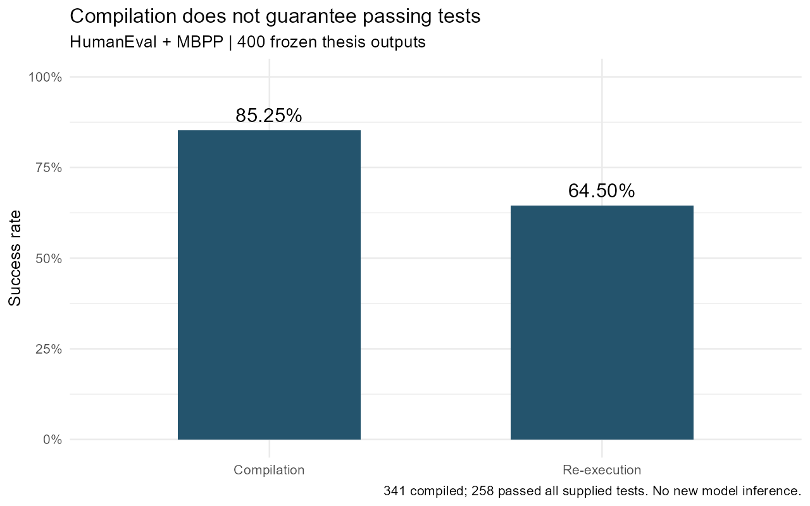

# Evaluating Metrics for LLM-based Decompilers

My bachelor's thesis at LMU Munich examined how well automatic metrics reflect errors in code recovered by an LLM-based decompiler. I evaluated SK²Decompile across four datasets, compared its outputs with source code and IDA pseudocode, and used AUC and Spearman correlation to analyse metric effectiveness and agreement.

## Findings and contribution

High automatic scores sometimes accompanied confirmed semantic errors. Compilation and code similarity captured different aspects of output quality, while readability scores depended on the reference used. Re-execution gave the clearest separation between the manually reviewed groups in the controlled benchmarks.

I connected the automatic scores to manually classified code differences to identify what each metric revealed and where the metrics provided overlapping or complementary information. This analysis supports evaluation recommendations that combine behavioural checks with complementary metrics. A separate floating-point analysis examined numerical errors that the category labels did not describe in enough detail.



## Evaluation

| Dataset | Role |
|---|---|
| HumanEval and MBPP | Compilation, test execution and source-code comparison |
| GitHub2025 | Function-name recovery |
| DecBench | Source and binary comparison for real-project functions |

The manual analysis used the C0–C14 decompilation taxonomy. AUC measured how well scores separated outputs with confirmed semantic differences from those with no confirmed difference. Spearman correlation compared metric rankings. Results were analysed by dataset and optimisation condition, with valid sample counts retained for each comparison.

## Run the analysis

The repository includes 400 HumanEval/MBPP metric records from the thesis experiments. The script produces score summaries, results by optimisation level and pairwise Spearman correlations.

```sh
python -m pip install -r requirements.txt
python scripts/analyze.py
```

- [Results and detailed statistics](results/REPORT.md)
- [Metric records and field definitions](data/README.md)
- [Analysis code](scripts/analyze.py)

To redraw the figure, install R and ggplot2, then run `Rscript --vanilla scripts/plot.R`.

## References

- Yifan Yang. *Evaluating and Enhancing Metrics for LLM-based Decompilers*. Bachelor's thesis, LMU Munich, 2026. Supervisor: Johannes Kinder; co-supervisor: Yunru Wang.
- SK²Decompile, the evaluated two-stage decompiler.

The numerical export and its source-file hashes are recorded in `provenance.json`.
